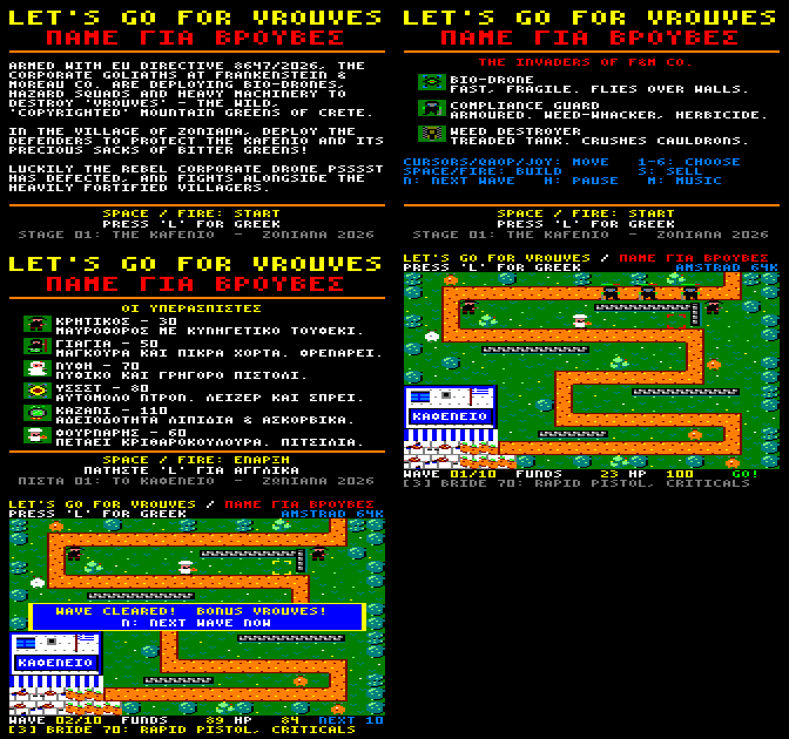

# LET'S GO FOR VROUVES / ΠΑΜΕ ΓΙΑ ΒΡΟΥΒΕΣ

A top-down tower defence game for the **Amstrad CPC 64K** (Mode 0, 160×200, 16 colours),
written in Z80 assembly.

Armed with EU Directive 8647/2026, Frankenstein & Moreau CO. send bio-drones, compliance
squads and weed-destroying tanks to wipe out the wild, "copyrighted" *vrouves* of Crete.
In Zoniana, the villagers have to protect the Kafenio and its sacks of bitter greens.
The rebel corporate drone **Psssst** has defected to their side.



## Running

```bash
./build.sh
```

This writes `build/vrouves.dsk` (and `build/vrouves.sna`, a snapshot for quick loading; the
game still reads its title screen and stages from the disk, so keep the disk inserted).
Insert the disk in any CPC emulator or a real 464/664/6128 with a disc drive and type:

```
RUN"VROUVES
```

A small BASIC loader (`VROUVES.BAS`) shows the REVIVE8BIT screen (`assets/revive8b.scr`)
and then the splash screen, each for 10 seconds or until SPACE / FIRE, then runs
`VROUVES.BIN`. The splash is made by `tools/make_splash.py` from `assets/vrouves.jpeg`: 16
inks picked from the 27 CPC colours, light dithering and the title in the game's font.

### On cassette

`build.sh` also writes `build/vrouves.cdt`, the cassette version, for a 464 (or any CPC with
`|TAPE`):

```
RUN"
```

It has no loading screens. `VROUVES.BIN` loads with the firmware at 1000 baud; then the
game's own loader (`src/tape.asm`, about 1600 baud, the border striping) reads the title
screen, and each stage in turn as it is reached, so the tape just runs on: leave it in the
deck and do not rewind. A stage lost with a life left is played again at once, without
loading; after the last one the ending loads, and after a game lost for good (or the ending)
SPACE resets the CPC. If a block fails to load, wind the tape
back a little and press PLAY: the loader waits for the block it wants.

## Controls

| Key | Action |
| --- | --- |
| Cursor keys / Q A O P / joystick | Move the build cursor |
| 1 – 9 | Choose a defender |
| SPACE / RETURN / ENTER / COPY / FIRE | Build on the cursor tile |
| S / DEL | Sell the defender under the cursor (half price back) |
| N | Call the next wave now (half the seconds left on the countdown are paid as a bonus) |
| H | Pause / continue |
| ESC | Quit to the title: it asks first, a second ESC quits (H continues) |
| L | Switch English / Greek at any time |
| M | Music on / off |

On the title screen, → (or joystick right) flips between the pages: a scene with the keys, the story, the defenders, the invaders and the high scores. D picks the difficulty.

## Difficulty

The difficulty, chosen on the title screen with D and shown under the title, is the number of
lives for the whole game: Easy 4, Medium 3 (the default), Hard 2, Hardest none. A stage lost
with a life left costs one and is played again from the start, with the score put back to what
it was when the stage began; the lives left show in the top bar next to the score.

## Score

The score runs through a whole game and shows in the top bar: the damage each invader stopped
would have done (4 / 8 / 20), the damage of each defender built (taken off again when it is
sold), the seconds left whenever a wave is called early, and the vrouves left after each stage
won. A game that ends with one of the eight best scores asks for a three letter name; the table
is the disk file `HISCORE.BIN` (one sector at a fixed place, written by `hiscore.asm`'s own
write routine). The cassette version counts the score but keeps no table.

## Defenders

| # | Defender | Cost | From stage | Notes |
| --- | --- | --- | --- | --- |
| 1 | Cretan | 35 | 1 | Hunting rifle, hits drones and walkers |
| 4 | Psssst | 80 | 1 | The defected drone. Laser that also strips armour. Hovers, so it can sit on walls, trees and other blocked tiles |
| 2 | Yiayia | 50 | 2 | Staff of chastisement and a pot of bitter leaves: slows everything near her, heavy close bash |
| 3 | Bride | 70 | 3 | Rapid pistol, 1 in 4 shots is a triple-damage critical |
| 6 | Baker | 60 | 4 | Hurls dakos (barley rusks) with splash damage |
| 5 | Cauldron | 110 | 5 | Toxic "unlicensed lipids and ascorbic acids": area damage that ignores armour, slows walkers |
| 7 | Lyra player | 90 | 8 | His tune hits every invader around him, walkers and drones, and charms the drones into slowing down; small damage, armour counts |
| 8 | Shepherd | 70 | 10 | Sling with a long reach; his stones throw the guards back along the road |
| 9 | Priest | 60 | 13 | Blesses his neighbours (they reload twice as fast) and rings his bell, which holds the drones and guards around him still for a moment; tanks pay no heed |

The village joins the fight bit by bit: the Kafenio is held by the Cretan and Psssst, every
following stage up to the school brings one more defender, and the Lyra player comes at the
sheepfold (stage 8), the Shepherd at the dairy (stage 10) and the Priest at the monastery
(stage 13), each announced when the stage begins. At the wedding (stage 20) the Bride and the
Priest are at the altar and cannot be built.

Neighbours matter. A defender right next to its partner (left, right, above or below, not
diagonally) hits harder or softer; the bonus shows on the info line, green or red, before
it is built:

| Defender | next to | Damage |
| --- | --- | --- |
| Bride | a Cretan | +50% |
| Yiayia | a Baker | +20% |
| Baker | a Cretan | -50% |
| Psssst | a Cretan | -20% |
| Lyra player | another Lyra player | -50% |
| Lyra player | a Yiayia | +50% |
| Shepherd | a Lyra player | +50% |

The Priest's blessing is not part of this list: every defender next to a Priest reloads twice
as fast, however many there are (`bless` in `priest.asm`).

At most three defenders have a bonus at a time: those that have one keep it while their
partner stays, and when one is lost it passes to the next in line (`syn_update`). Penalties
always count. The pairs are a list (`syn_tab` in `synergy.asm`), and the first that applies
counts: a Lyra player next to both another one and a Yiayia gets the -50%.

## Invaders

* **Bio-drones** – fast and fragile; they fly a shortcut straight over the walls. Yiayia and the cauldron cannot reach them.
* **F&M compliance guards** – armoured walkers with weed-whackers and herbicide.
* **Weed destroyers** – treaded tanks with lots of health; they dent cauldrons next to the road, putting them out of action for a few seconds.

## Stages

1. **The Kafenio** – the road winds down from the hills to the village café, its porch stacked
   with sacks of vrouves.
2. **The village church** – the greens are hidden in the church courtyard, with the priest and
   the candle stand. The road is shorter and every wave a little bigger.
3. **The town hall** – on the plaza under the old plane tree, by the fountain and the mayor;
   the Greek and the EU flag fly over the portico. The invaders here are tougher: they come
   with the health they would have two waves later.
4. **The bakery** – in the yard of the village bakery by its wood-fired oven, among the
   woodpile and the racks of drying dakos. The road crosses the map in three close lanes, and
   the invaders come with the health of the next wave.
5. **The school** – in the schoolyard with its basketball court, the flag and the teacher.
   The waves are the biggest of all.
6. **The village pitch** – the greens wait on the touchline by the coach and the team bench,
   below stands full of villagers. The road runs around the pitch, which is buildable grass;
   the drones fly straight across it.
7. **The cemetery church** – the little stone chapel among the graves and cypresses, with the
   priest and a yiayia in black by the oil lamps. The road winds between the graves, where
   nothing can be built.
8. **The sheepfold** – high on the mountain, in the yard of the mitato, the shepherd's stone
   hut. The road winds down in hairpins between rocks, dry-stone walls and sheep, and the
   waves bring swarms of drones. The Lyra player joins in.
9. **The olive press** – by the millstone and the storage jars. The walkers come along two
   roads, one from each side, every other one taking the second; the roads meet below the
   yard. Each road is short, so the waves are smaller.
10. **The cheese dairy** – the whitewashed dairy with milk churns and cheeses in the yard; the
    road takes a long way round between dry-stone walls and sheep. The Shepherd joins in.
11. **The watermill** – the stone mill with its wheel, by a stream. Two roads, which meet in
    the middle of the map.
12. **The Sfendoni cave** – the dark mouth of the cave in the rock face, rocks everywhere.
    Two roads, one from each side, which become one.
13. **The monastery** – the dome, the cells and the abbot in the court; the road goes round
    the monastery. The Priest joins in.
14. **The beehives** – the beekeeper's hut with its jars of honey, the road up and down in
    narrow lanes between the hives.
15. **The raki still** – the copper still on its fire under a reed roof; the road comes down
    in three long hairpins.
16. **The windmills** – one big white windmill and small ones all over the map; the longest,
    most winding road of the game.
17. **The threshing floor** – the round stone floor, the granary and the haystacks; the road
    spirals in to the middle.
18. **The vineyard** – the winery with its barrels and vines between the roads. Two roads,
    one from above and one from below.
19. **The summit chapel** – the little stone chapel on the top of Psiloritis, among the
    rocks; the road climbs in tight hairpins.
20. **The Bride's wedding** – the last stand, in the church courtyard of stage 2 decked out for
    the wedding, the groom at the door, the road winding between the guests' tables. No Bride
    and no Priest here, they are at the altar, and a column of tanks in the last wave.

Stages 10 to 19 come from the Android version (VrouvesAndroid 1.1), with their maps, roads and
waves.

Each stage has ten waves and starts with fresh funds. Every invader that reaches the building
steals greens; the sacks disappear as its HP drops. Survive all ten waves to move on to the
next stage; lose, and you play it again if you have a life left (see Difficulty), or it is
back to the title screen. Win the last stage and the whole village
celebrates at the Bride's wedding (`assets/wedding_sceneFinal.png`); SPACE / FIRE goes back to
the title screen. The picture is rendered in Blender by `tools/wedding_blender.py` (with the
shared `tools/blender_toon.py`; `blender -b --python tools/wedding_blender.py -- out.png`) and
turned into CPC colours by `tools/make_ending.py`.

## Building

Requirements: `python3` with Pillow, [rasm](https://github.com/EdouardBERGE/rasm) and
[iDSK](https://github.com/cpcsdk/idsk).

* `tools/gen_assets.py` generates `src/gen/assets.asm`: the 3×6 font (Latin and Greek), the
  sprites (`tools/art.py`), all English/Greek text (`tools/texts.py`, byte-pair compressed),
  the music and sound effects; `src/gen/title_text.asm` and `src/gen/title_art.asm`, the texts and the packed
  first-page picture only the title screen needs;
  and one file per stage, `build/STAGE1.BIN` to `STAGE20.BIN`, all padded to the same length: the map rendered to 8×12
  tiles, the cell types, the enemy paths, the sacks, the flag position, the waves and the
  stage's own texts, the defenders it has, how tough its invaders are and where its second
  road starts, in a fixed layout. Preview PNGs go to `build/preview/`. The stages with the
  Lyra player (8 to 20) keep the top of the stage area free for him, the Shepherd and the
  Priest: `src/gen/extra.asm` has their pictures, sounds and texts.
* `build.sh` puts the stage files on a fresh disk first, asks `tools/diskmap.py` where they
  landed (`src/gen/diskmap.asm`: the first stage's sector and the stride, since the stage
  files lie one after the other and the loader computes where each one is), assembles, adds the title overlay `TITLE.BIN` and
  `VROUVES.BIN`, and checks that every file is where the loader will look for it. The
  assembly also gives `LYRA.BIN`, the code and data of the later defenders (`src/lyra.asm`,
  `src/shepherd.asm`, `src/priest.asm`), which `tools/put_extra.py` writes into the top of
  stages 8–20 before the disk is made again with
  the same files in the same places. Then it assembles again with `-DTAPE=1` (its own
  `LYRA.BIN`, in the tape copies of the stages) and has `tools/make_cdt.py` write the
  cassette image.
* `src/main.asm` is the entry point and memory map; `hw.asm` (interrupts, keyboard, AY
  sound), `gfx.asm` (double buffering, sprites, dirty rectangles, text), `game.asm`,
  `disk.asm` (the disk loader), `tape.asm` (the cassette loader, instead of it with
  `-DTAPE=1`) and `title.asm` (assembled into the title overlay).
* `RASMFLAGS="-DDEBUG=9" ./build.sh` builds a debug version that starts with plenty of money
  at wave 9 and every defender; `-DSTART_STAGE=n` starts at stage n; add `-DMETER=1` to show how many 50 Hz
  frames each drawn frame took (top right).

### Headless testing

`tools/cpcsim.py` is a small headless CPC (Z80 core from the `z80` Python package, keyboard
through the PPI/AY, gate array palette, CRTC base, 300 Hz interrupts, and the disc
controller reading `build/vrouves.dsk`) that renders the shown
screen to PNG and stops on a crash (PC or SP out of range). On top of it,
`tools/scenario.py stress` builds two dozen defenders and runs a late wave,
`tools/bench.py` (on a `-DDEBUG=9` build) reports the frame rate in that fight and
`tools/profile.py` where the CPU time goes (set `CPC_SPEED=0.8` to approximate the CPC's
memory wait states), `tools/costs.py <wave>` the time per game activity,
`tools/ghosts.py` checks that no sprite leftovers remain on either screen between waves,
`tools/enemycheck.py [stress]` checks at every flip that every enemy is fully drawn, and
`tools/scenario.py full` plays a whole game, all stages, with a build order per stage,
printing progress per wave — handy for balancing, and `tools/scenario.py stage <n> [-v]` plays
just stage n. `tools/lyracheck.py` checks the Lyra player, the two roads of the olive press, the
Shepherd's knockback, the Priest's bell and blessing and the wedding without the Bride and
the Priest, `tools/endcheck.py` the ending after the last stage, `tools/syncheck.py` the neighbour bonus and
`tools/scorecheck.py` the score and the lives. The tools work on whichever stage the build
starts at.

### Testing in Caprice32

`tools/run.sh <autocmd-file>` boots the disk in the Caprice32 snap with a private config and
screenshot folder, typing the given autocmd script. `tools/script.py` composes such scripts
(`W<n>` idles, `S` takes a screenshot, `R L U D` move the cursor, `_` is space) and
`tools/place.py` produces cursor moves to build towers at given cells.

## Technical notes

* The firmware is switched off; the game owns all 64K. Memory map: code and data from `#0040`,
  the current stage just below `#4000`, screen buffers at `#4000` and `#C000`, a copy of the
  playfield background at `#8000`, line tables, sprite mask table, dirty-rectangle lists and
  entity tables up to `#BEFF`. The neighbour bonus (`synergy.asm`) and parts of the score
  (`score.asm`) run from the hidden 48 byte tails of eight screen blocks, copied there from
  the title overlay when a game starts (`tails.asm`), which also builds the enemy dispatch
  blocks and the mirrored frames in the other eight tails then, once a game. The Lyra player
  (`lyra.asm`, with his picture, sound and texts) is not resident either: he lives at the top
  of the stage area, in the files of the stages that have him. The title screen's code and texts are an overlay that is loaded
  into the background buffer whenever the title is shown. The ending, `ENDING.SCR`, loads
  straight onto the `#C000` screen; its inks and the few bytes of code that show it sit in
  the hidden tails of the screen blocks (`tools/png_to_scr.py`), so it costs the resident
  code only a call.
* With the firmware off, `disk.asm` drives the µPD765 disc controller itself: motor on,
  recalibrate, seek, and read data sector by sector (interrupts held off during each sector,
  retries on errors) straight to the destination; the music is held meanwhile. Files are
  stored without an AMSDOS header, and their tracks and sectors are fixed at build time.
* The playfield is double buffered. Every sprite drawn on a buffer leaves a rectangle in that
  buffer's list, which is restored from the background copy before the next frame is drawn there.
* Sprites use pen 0 as transparent and a 256-byte mask table, so they are stored at one byte
  per two pixels; black inside sprites uses pen 15.
* The screen is drawn at a fixed 12.5 frames per second (every fourth 50 Hz frame), with the
  game logic running two ticks per drawn frame (25 Hz), so the pace never changes however busy
  the battle gets. `FRAMES_PER_DRAW equ 2` in `src/hw.asm` draws at up to 25 fps instead:
  about 24–25 fps in waves 1–7 and 19–23 fps in the busiest late waves, where sixteen walkers
  on screen alone take most of two frames to draw. The logic then runs as many 25 Hz ticks as
  frames passed (at most two), so the pace stays the same.
* Enemies are only redrawn when they change: per screen buffer the game remembers where and
  with which sprite each enemy was last drawn; restored rectangles stamp a 16×16 cell map and
  an unchanged enemy is redrawn only if one of its cells was restored. There are no health bars.
* Per 25 Hz tick at most four towers look for a target; input handling is skipped when no key
  is down; a cauldron draws at most two clouds per throw; up to eight effects at a time. Music and effects on the AY are driven from the 50 Hz interrupt.
* Rendering: sprites step down screen lines arithmetically and use an unrolled, width-indexed
  inner loop; background restores copy rows of up to 8 bytes with unrolled `LDI` (C = 255 so
  `LDI` never touches the row counter in B, line steps patched in, wider rectangles in 8-byte
  strips), and stamping the cell map is a short page-local loop; row counters live in a shadow register;
  HUD text changes are written to the back screen only, spreading the cost over two frames.
* Enemies have their own 8×12 routine: each row is drawn by a handler for its kind (all
  opaque, middle opaque, middle opaque with empty edges, masked), opaque bytes are copied with
  `LDI`, and for every pattern of rows the game writes a list of 12 `CALL`s into the hidden tail
  of a `#4000` screen block, so nothing is decoded while drawing. Left-facing frames are
  mirrored when a game starts into the hidden tails of the `#C000` screen. A guard takes about 2900 T
  states instead of 4080, a tank 2050–2300.
