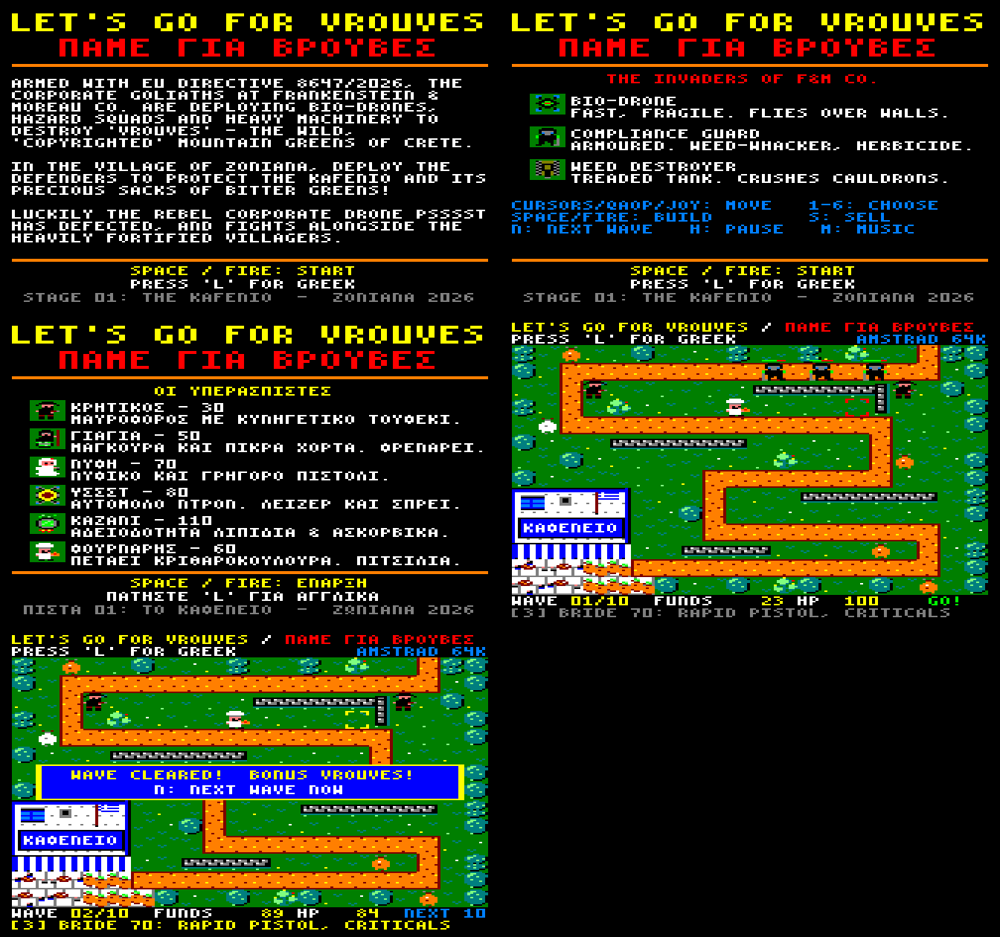

# LET'S GO FOR VROUVES / ΠΑΜΕ ΓΙΑ ΒΡΟΥΒΕΣ

A top-down tower defence game for the **Amstrad CPC 64K** (Mode 0, 160×200, 16 colours),
written in Z80 assembly.

Armed with EU Directive 8647/2026, Frankenstein & Moreau CO. send bio-drones, compliance
squads and weed-destroying tanks to wipe out the wild, "copyrighted" *vrouves* of Crete.
In Zoniana, the villagers have to protect the Kafenio and its sacks of bitter greens.
The rebel corporate drone **Psssst** has defected to their side.



## Running

```bash
./build.sh
```

This writes `build/vrouves.dsk` (and `build/vrouves.sna`, a snapshot for quick loading).
Insert the disk in any CPC emulator or a real 464/664/6128 with a disc drive and type:

```
RUN"VROUVES
```

## Controls

| Key | Action |
| --- | --- |
| Cursor keys / Q A O P / joystick | Move the build cursor |
| 1 – 6 | Choose a defender |
| SPACE / RETURN / ENTER / COPY / FIRE | Build on the cursor tile |
| S / DEL | Sell the defender under the cursor (half price back) |
| N | Call the next wave now (half the seconds left on the countdown are paid as a bonus) |
| H | Pause / continue (ESC while paused quits to the title) |
| L | Switch English / Greek at any time |
| M | Music on / off |

On the title screen, → (or joystick right) flips between the story, defenders and invaders pages.

## Defenders

| # | Defender | Cost | Notes |
| --- | --- | --- | --- |
| 1 | Cretan | 30 | Hunting rifle, hits drones and walkers |
| 2 | Yiayia | 50 | Staff of chastisement and a pot of bitter leaves: slows everything near her, heavy close bash |
| 3 | Bride | 70 | Rapid pistol, 1 in 4 shots is a triple-damage critical |
| 4 | Psssst | 80 | The defected drone. Laser that also strips armour. Hovers, so it can sit on walls, trees and other blocked tiles |
| 5 | Cauldron | 110 | Toxic "unlicensed lipids and ascorbic acids": area damage that ignores armour, slows walkers |
| 6 | Baker | 60 | Hurls dakos (barley rusks) with splash damage |

## Invaders

* **Bio-drones** – fast and fragile; they fly a shortcut straight over the walls. Yiayia and the cauldron cannot reach them.
* **F&M compliance guards** – armoured walkers with weed-whackers and herbicide.
* **Weed destroyers** – treaded tanks with lots of health; they dent cauldrons next to the road, putting them out of action for a few seconds.

Stage 01 has ten waves. Every invader that reaches the Kafenio steals greens; the sacks on the
porch disappear as the Kafenio's HP drops. Survive all ten waves to win.

## Building

Requirements: `python3` with Pillow, [rasm](https://github.com/EdouardBERGE/rasm) and
[iDSK](https://github.com/cpcsdk/idsk).

* `tools/gen_assets.py` generates `src/gen/assets.asm`: the 3×6 font (Latin and Greek), the
  sprites (`tools/art.py`), the Stage 01 map rendered to 8×12 tiles, the enemy paths, all
  English/Greek text (`tools/texts.py`, byte-pair compressed), the music, sound effects and
  waves. Preview PNGs go to `build/preview/`.
* `src/main.asm` is the entry point and memory map; `hw.asm` (interrupts, keyboard, AY
  sound), `gfx.asm` (double buffering, sprites, dirty rectangles, text), `game.asm`, `title.asm`.
* `RASMFLAGS="-DDEBUG=9" ./build.sh` builds a debug version that starts with plenty of money
  at wave 9; add `-DMETER=1` to show how many 50 Hz frames each drawn frame took (top right).

### Headless testing

`tools/cpcsim.py` is a small headless CPC (Z80 core from the `z80` Python package, keyboard
through the PPI/AY, gate array palette, CRTC base, 300 Hz interrupts) that renders the shown
screen to PNG and stops on a crash (PC or SP out of range). On top of it,
`tools/scenario.py stress` builds two dozen defenders and runs a late wave,
`tools/bench.py` (on a `-DDEBUG=9` build) reports the frame rate in that fight and
`tools/profile.py` where the CPU time goes (set `CPC_SPEED=0.8` to approximate the CPC's
memory wait states), `tools/costs.py <wave>` the time per game activity,
`tools/ghosts.py` checks that no sprite leftovers remain on either screen between waves,
`tools/enemycheck.py [stress]` checks at every flip that every enemy is fully drawn, and
`tools/scenario.py full` plays a whole game with a build order, printing progress per wave —
handy for balancing (a full ten-wave game simulates in a few seconds).

### Testing in Caprice32

`tools/run.sh <autocmd-file>` boots the disk in the Caprice32 snap with a private config and
screenshot folder, typing the given autocmd script. `tools/script.py` composes such scripts
(`W<n>` idles, `S` takes a screenshot, `R L U D` move the cursor, `_` is space) and
`tools/place.py` produces cursor moves to build towers at given cells.

## Technical notes

* The firmware is switched off; the game owns all 64K. Memory map: code and data from `#0040`,
  screen buffers at `#4000` and `#C000`, a copy of the playfield background at `#8000`, line
  tables, sprite mask table, dirty-rectangle lists and entity tables up to `#BEFF`.
* The playfield is double buffered. Every sprite drawn on a buffer leaves a rectangle in that
  buffer's list, which is restored from the background copy before the next frame is drawn there.
* Sprites use pen 0 as transparent and a 256-byte mask table, so they are stored at one byte
  per two pixels; black inside sprites uses pen 15.
* The screen is drawn at a fixed 12.5 frames per second (every fourth 50 Hz frame), with the
  game logic running two ticks per drawn frame (25 Hz), so the pace never changes however busy
  the battle gets. `FRAMES_PER_DRAW equ 2` in `src/hw.asm` draws at up to 25 fps instead:
  about 24–25 fps in waves 1–7 and 19–23 fps in the busiest late waves, where sixteen walkers
  on screen alone take most of two frames to draw. The logic then runs as many 25 Hz ticks as
  frames passed (at most two), so the pace stays the same.
* Enemies are only redrawn when they change: per screen buffer the game remembers where and
  with which sprite each enemy was last drawn; restored rectangles stamp a 16×16 cell map and
  an unchanged enemy is redrawn only if one of its cells was restored. There are no health bars.
* Per 25 Hz tick at most four towers look for a target; input handling is skipped when no key
  is down; a cauldron draws at most two clouds per throw; up to eight effects at a time. Music and effects on the AY are driven from the 50 Hz interrupt.
* Rendering: sprites step down screen lines arithmetically and use an unrolled, width-indexed
  inner loop; background restores use unrolled `LDI`; row counters live in a shadow register;
  HUD text changes are written to the back screen only, spreading the cost over two frames.
* Enemies have their own 8×12 routine: each row is drawn by a handler for its kind (all
  opaque, middle opaque, middle opaque with empty edges, masked), opaque bytes are copied with
  `LDI`, and for every pattern of rows the game writes a list of 12 `CALL`s into the hidden tail
  of a `#4000` screen block, so nothing is decoded while drawing. Left-facing frames are
  mirrored at start-up into the hidden tails of the `#C000` screen. A guard takes about 2900 T
  states instead of 4080, a tank 2050–2300.
