# ΠΑΜΕ ΓΙΑ ΒΡΟΥΒΕΣ

*Ένα παιχνίδι tower defence για τον Amstrad CPC 64K*

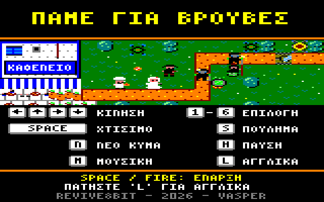

## Η ιστορία

Οπλισμένοι με την Οδηγία ΕΕ 8647/2026, οι κολοσσοί της **Frankenstein & Moreau Co.**
στέλνουν βιο-ντρόνα, συνεργεία και βαριά μηχανήματα για να ξεριζώσουν τις *βρούβες* – τα
άγρια, «κατοχυρωμένα» χόρτα των βουνών της Κρήτης.

Στα Ζωνιανά οι χωριανοί δεν το δέχονται. Στήσε τους υπερασπιστές για να προστατέψεις το
καφενείο, την εκκλησία, το δημαρχείο και όλο το χωριό, και πάνω απ' όλα τα πολύτιμα τσουβάλια
με τα πικρά χόρτα. Ευτυχώς το επαναστατημένο εταιρικό ντρον **Ψσσστ** αυτομόλησε και πολεμά
δίπλα στους οχυρωμένους χωριανούς.

## Φόρτωμα

Χρειάζεσαι Amstrad CPC 464, 664 ή 6128 με δισκέτα (ή έναν εξομοιωτή) και την εικόνα δισκέτας
`vrouves.dsk`. Βάλε τη δισκέτα και γράψε:

```
RUN"VROUVES
```

Πρώτα εμφανίζονται η οθόνη REVIVE8BIT και η εισαγωγική εικόνα του παιχνιδιού, η καθεμία για 10
δευτερόλεπτα ή μέχρι να πατήσεις SPACE / FIRE· μετά φορτώνει το παιχνίδι.

Άφησε τη δισκέτα στον δισκοδρίβη: το παιχνίδι διαβάζει από εκεί την αρχική οθόνη και κάθε
πίστα την ώρα που παίζεις. Κάθε φορά υπάρχει μια σύντομη παύση με μαύρη οθόνη.

## Η αρχική οθόνη

Η αρχική οθόνη ανοίγει με μια σκηνή από το παιχνίδι και τα βασικά πλήκτρα, μετά λέει την
ιστορία και δείχνει τους υπερασπιστές και τους εισβολείς.

| Πλήκτρο | Τι κάνει |
| --- | --- |
| SPACE / FIRE | Αρχή του παιχνιδιού |
| → (ή joystick δεξιά) | Επόμενη σελίδα |
| L | Εναλλαγή Ελληνικά / Αγγλικά |
| M | Μουσική ναι / όχι |

## Η οθόνη του παιχνιδιού

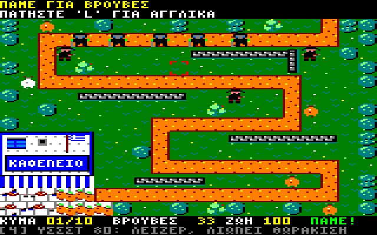

* **Η πάνω μπάρα** δείχνει την πίστα και μηνύματα («χτίσε και πάτα N για το κύμα», «το κύμα
  αποκρούστηκε»). Όταν δεν έχει κάτι να πει, δείχνει τον τίτλο του παιχνιδιού.
* **Το πεδίο** είναι το χωριό. Οι εισβολείς έρχονται από τον δρόμο· τα ντρόνα πετούν από τον
  δικό τους δρόμο, πάνω από τοίχους και δέντρα. Οι υπερασπιστές σου μπαίνουν στο γρασίδι
  δίπλα.
* **Η κάτω μπάρα** δείχνει το κύμα (π.χ. `03/10`), τις βρούβες σου (τα λεφτά του χωριού), τη
  ζωή του κτιρίου που προστατεύεις και τα δευτερόλεπτα ως το επόμενο κύμα (`ΣΕ`), ή `ΠΑΜΕ!`
  όσο κρατά ένα κύμα. Από κάτω, ο υπερασπιστής που διάλεξες με το πλήκτρο του, την τιμή του
  και τι κάνει. Όταν ο κέρσορας είναι πάνω σε δικό σου υπερασπιστή, δείχνει πόσα θα πάρεις αν
  τον πουλήσεις.

## Χειρισμός

| Πλήκτρο | Τι κάνει |
| --- | --- |
| Βελάκια / Q A O P / joystick | Μετακίνηση του κέρσορα |
| 1 – 6 | Επιλογή υπερασπιστή (μόνο όσοι υπάρχουν σε αυτή την πίστα) |
| SPACE / RETURN / ENTER / COPY / FIRE | Χτίσιμο του υπερασπιστή στον κέρσορα |
| S / DEL | Πούλημα του υπερασπιστή κάτω από τον κέρσορα |
| N | Το επόμενο κύμα τώρα |
| H | Παύση / συνέχεια· ESC στην παύση γυρνά στην αρχική οθόνη |
| L | Εναλλαγή Ελληνικά / Αγγλικά, οποιαδήποτε στιγμή |
| M | Μουσική ναι / όχι |

Ο κέρσορας αναβοσβήνει άσπρος και κίτρινος όταν μπορείς να χτίσεις εκεί, και γίνεται κόκκινος
όταν δεν μπορείς: το κελί είναι πιασμένο, δεν είναι γρασίδι ή δεν σου φτάνουν οι βρούβες.

## Πώς παίζεται

* Κάθε πίστα έχει **δέκα κύματα**. Πριν από το πρώτο έχεις 45 δευτερόλεπτα για να χτίσεις·
  ανάμεσα στα κύματα, 15. Κάθε πίστα ξεκινά με **120 βρούβες** και **100 ζωή**.
* Κάθε εισβολέας που σταματάς σε πληρώνει: 3 το ντρον, 4 ο φύλακας, 10 το τανκ. Όταν
  αποκρούεις ένα κύμα παίρνεις μπόνους 15 + 3 × τον αριθμό του κύματος.
* Σε παίρνει; Πάτα **N** για να φέρεις νωρίτερα το επόμενο κύμα: τα μισά δευτερόλεπτα που
  έμεναν στην αντίστροφη μέτρηση σου δίνονται μπόνους.
* Όταν πουλάς έναν υπερασπιστή παίρνεις πίσω περίπου τη μισή του τιμή.
* Κάθε εισβολέας που φτάνει στο κτίριο κλέβει χόρτα: το ντρον κοστίζει 4 ζωή, ο φύλακας 8,
  το τανκ 20. Τα τσουβάλια με τις βρούβες χάνονται ένα ένα όσο πέφτει η ζωή. Στο 0 η πίστα
  χάνεται και γυρνάς στην αρχική οθόνη.
* Αν αντέξεις και τα δέκα κύματα, περνάς στην επόμενη πίστα. Κέρδισε και την τελευταία, και οι
  βρούβες σώθηκαν!

## Οι υπερασπιστές

Δεν είναι όλοι έτοιμοι από την αρχή: το καφενείο το κρατούν ο Κρητικός και ο Ψσσστ, και κάθε
επόμενη πίστα φέρνει έναν ακόμη υπερασπιστή στο χωριό. Κάθε νέος υπερασπιστής ανακοινώνεται
στην αρχή της πίστας του.

| | Πλήκτρο | Υπερασπιστής | Τιμή | Από την πίστα | Τι κάνει |
| --- | --- | --- | --- | --- | --- |
| 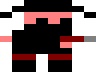 | 1 | **Κρητικός** | 35 | 1 | Μαυροφορεμένος, με κυνηγετικό τουφέκι. Χτυπά ντρόνα και πεζούς. |
|  | 4 | **Ψσσστ** | 80 | 1 | Το ντρον που αυτομόλησε. Το λέιζερ του λιώνει και τη θωράκιση. Αιωρείται, οπότε κάθεται και σε τοίχους, δέντρα, τάφους και άλλα κελιά όπου δεν χτίζεται τίποτα. |
| 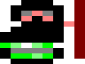 | 2 | **Γιαγιά** | 50 | 2 | Μαγκούρα και τσουκάλι με πικρά χόρτα: φρενάρει κάθε πεζό κοντά της και ρίχνει στον πιο κοντινό μια γερή. Τα ντρόνα δεν τα φτάνει. |
|  | 3 | **Νύφη** | 70 | 3 | Νυφικό και γρήγορο πιστόλι. Μία στις τέσσερις βολές είναι κρίσιμη, με τριπλή ζημιά. |
|  | 6 | **Φούρναρης** | 60 | 4 | Πετάει ντάκους (κριθαροκούλουρα) που πιτσιλάνε ό,τι είναι γύρω από τον στόχο. |
| 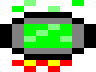 | 5 | **Καζάνι** | 110 | 5 | Τοξικό σύννεφο από «αδειοδότητα λιπίδια και ασκορβικά οξέα»: χτυπά κάθε πεζό γύρω του, αγνοώντας τη θωράκιση, και τον φρενάρει. Τα ντρόνα δεν τα φτάνει, και τα τανκς το στραπατσάρουν όταν περνούν δίπλα. |

## Οι εισβολείς

| | Εισβολέας | Τι κάνει |
| --- | --- | --- |
| 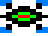 | **Βιο-ντρον** | Γρήγορο και εύθραυστο. Πετά από δικό του σύντομο δρόμο πάνω από τοίχους και δέντρα, οπότε το φτάνουν μόνο ο Κρητικός, ο Ψσσστ, η Νύφη και ο Φούρναρης. |
| 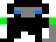 | **Φύλακας συμμόρφωσης της F&M** | Θωρακισμένος, με χορτοκοπτικό και ζιζανιοκτόνο. Η θωράκιση τρώει ένα μέρος από κάθε χτύπημα, εκτός από το σύννεφο του Καζανιού· το λέιζερ του Ψσσστ τη λιώνει. |
| 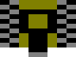 | **Καταστροφέας χόρτων** | Ερπυστριοφόρο τανκ με πολλή θωράκιση και ζωή. Στραπατσάρει τα Καζάνια δίπλα στον δρόμο και τα βγάζει εκτός μάχης για λίγα δευτερόλεπτα· αν περάσει, κοστίζει 20 ζωή. |

Οι εισβολείς δυναμώνουν σε κάθε κύμα. Σε μερικές πίστες έρχονται ακόμη πιο δυνατοί.

## Οι πίστες

<div class="stage" markdown="1">

**1. Το καφενείο.** Ο δρόμος κατεβαίνει από τα βουνά στο καφενείο του χωριού, με τη βεράντα
γεμάτη τσουβάλια με βρούβες.

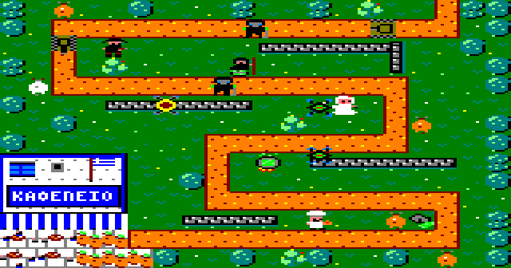

</div>

<div class="stage" markdown="1">

**2. Η εκκλησία του χωριού.** Τα χόρτα είναι κρυμμένα στην αυλή της εκκλησίας, δίπλα στον
παπά και στο μανουάλι. Ο δρόμος είναι πιο κοντός και τα κύματα λίγο μεγαλύτερα.

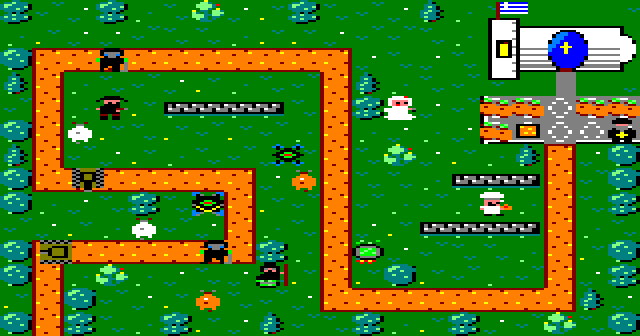

</div>

<div class="stage" markdown="1">

**3. Το δημαρχείο.** Στην πλατεία κάτω από τον γέρικο πλάτανο, δίπλα στη βρύση και στον
δήμαρχο. Εδώ οι εισβολείς είναι πιο δυνατοί από το συνηθισμένο.

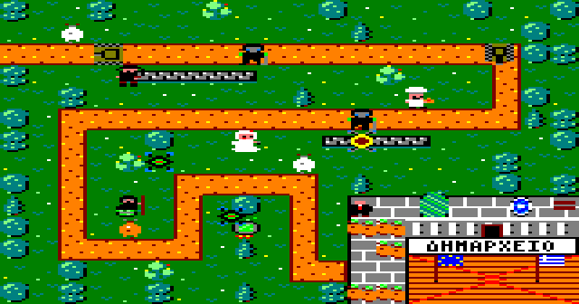

</div>

<div class="stage" markdown="1">

**4. Ο φούρνος.** Στην αυλή του φούρνου δίπλα στον ξυλόφουρνο, ανάμεσα στα ξύλα και στις
ψάθες με τα ντάκους που στεγνώνουν. Ο δρόμος διασχίζει τον χάρτη σε τρεις κοντινές λωρίδες.

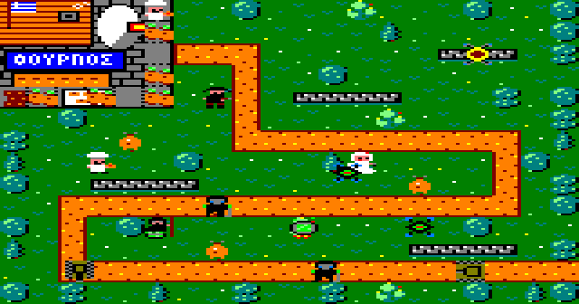

</div>

<div class="stage" markdown="1">

**5. Το σχολείο.** Στην αυλή του σχολείου με το γήπεδο του μπάσκετ, τη σημαία και τη δασκάλα.

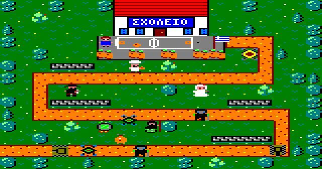

</div>

<div class="stage" markdown="1">

**6. Το γήπεδο του χωριού.** Τα χόρτα περιμένουν στην πλάγια γραμμή, δίπλα στον προπονητή και
στον πάγκο, κάτω από την κερκίδα γεμάτη χωριανούς. Ο δρόμος κάνει τον γύρο του γηπέδου και
μπορείς να χτίσεις και πάνω στο γρασίδι του· τα ντρόνα περνούν ίσια από πάνω του.

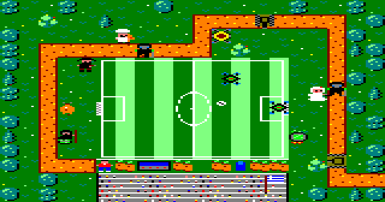

</div>

<div class="stage" markdown="1">

**7. Η εκκλησία του νεκροταφείου.** Η τελευταία μάχη, στο πέτρινο εκκλησάκι ανάμεσα στους
τάφους και στα κυπαρίσσια. Ο δρόμος περνά ανάμεσα από τους τάφους, όπου δεν χτίζεται τίποτα –
εκτός από τον Ψσσστ, που αιωρείται.

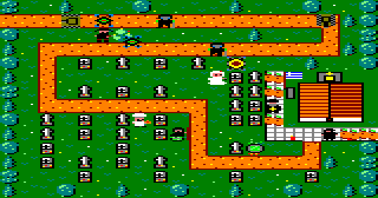

</div>

## Συμβουλές

* Ψάξε τις στροφές: ένας υπερασπιστής δίπλα σε δύο κομμάτια δρόμου πυροβολεί τα πάντα δύο
  φορές.
* Οι Κρητικοί είναι φτηνοί και χτυπούν τα πάντα, αλλά ένα κύμα από ντρόνα περνά άνετα από μια
  άμυνα που χτυπά μόνο πεζούς. Κράτα κάτι που χτυπά στον αέρα κοντά στον δρόμο των ντρόνων.
* Βάλε τη Γιαγιά στις στροφές του δρόμου, ώστε οι φρεναρισμένοι πεζοί να μένουν περισσότερο
  κάτω από τα πυρά.
* Απέναντι στους θωρακισμένους φύλακες και στα τανκς, το λέιζερ του Ψσσστ και το σύννεφο του
  Καζανιού αξίζουν τα λεφτά τους. Κράτα τα Καζάνια ένα βήμα μακριά από τον δρόμο, μακριά από
  τα τανκς.
* Ο Ψσσστ κάθεται σε τοίχους, δέντρα και τάφους: χρησιμοποίησε τα κελιά που δεν παίρνει
  κανένας άλλος.
* Φέρνε τα κύματα νωρίτερα όταν η άμυνά σου αντέχει άνετα: το μπόνους μαζεύεται.

---

*ΠΑΜΕ ΓΙΑ ΒΡΟΥΒΕΣ – REVIVE8BIT - 2026 - VASPER.*
